# Laporan Teknis QA & Test Automation: Standardisasi Format Surat & Modul Templating Resmi UNIK

Dokumen ini disusun sebagai panduan teknis bagi **QA Tester Agent** dan pengembang otomasi uji (*Cypress BDD*) dalam memetakan perubahan antarmuka, alur data, selektor DOM, serta penambahan kasus uji baru pasca-implementasi tata naskah dinas resmi Universitas Kadiri (UNIK) pada modul pembuatan surat dan modul perancangan template admin.

---

## 1. Ringkasan Eksekutif Perubahan

Untuk menyelaraskan sistem secara menyeluruh menjelang pelaksanaan UAT dan UEQ bersama mitra Universitas Kadiri, perbaikan tata naskah dinas kini telah mencakup pilar-pilar utama:

### A. Modul Pembuatan Surat (`/internal/surats/create` & `/internal/surats/{id}/edit`)
1. **Mode Scratch (WYSIWYG)**: Otomatis me-render tabel kepala surat, blok *"Kepada Yth."* bernomor resmi UNIK, naskah dinas, dan blok tembusan.
2. **Penyederhanaan Antarmuka (*Clean UI*) & *Progressive Disclosure***:
   - **Section "Tembusan & Penerima Khusus"**: Dikelompokkan ke dalam collapsible section yang tertutup (*collapsed*) secara default saat kosong, sehingga tidak memadati form surat biasa.
   - **Section "Penomoran Surat"**: Dibuat *collapsed* secara default untuk alur standar (penomoran otomatis saat surat dikirim).
   - **Section "Jalur Persetujuan Khusus"**: Menggunakan `defaultItems(0)` dan tertutup (*collapsed*) secara default bila tidak ada alur khusus yang didefinisikan.
3. **Otomatisasi Keterangan Lampiran (*Auto-updating Lampiran Counter*)**:
   - Field `content.lampiran_text` secara otomatis mendeteksi jumlah berkas yang diunggah (`lampirans`) atau dipilih dari pengajuan rujukan (`lampiran_pengajuan_dipilih`).
   - Rumus reaktif: 0 berkas $\to$ `"-"`, 1 berkas $\to$ `"1 Berkas"`, $N$ berkas $\to$ `"{N} Berkas"`.
   - Pengguna tetap memiliki kebebasan menyesuaikan secara manual (*manual override*) jika dibutuhkan.
4. **Eliminasi Jargon & Kosakata AI Klise**:
   - Label komponen formulir disederhanakan menjadi bahasa formal lugas: *"Jabatan Pengirim"*, *"Unit Tujuan"*, *"Perihal"*, *"Lampiran"*, *"Ringkasan Pengiriman"*, serta menghapus kalimat *helper text* yang bertele-tele.
5. **Sinkronisasi Non-Destruktif**: Tombol hint `"Perbarui Header & Kepada Yth"` pada editor TinyMCE memperbarui kepala surat dan daftar penerima sesuai isian formulir tanpa menghapus naskah yang diketik.
6. **Live Preview Reaktif**: Nilai `{{ perihal }}`, `{{ lampiran }}`, `{{ kepada }}`, dan `{{ tembusan }}` langsung ter-update secara reaktif pada pratinjau surat.

### B. Modul Perancangan Template Admin (`/internal/template-resource/templates/create`)
1. **Daftar Reserved Keywords Lengkap**: Kotak informasi template secara eksplisit merinci keyword bawaan sistem:
   - `{{ nomor_surat }}`: Nomor surat resmi (digenerate saat kirim/backdate).
   - `{{ tanggal_surat }}`: Tanggal surat (contoh: 31 Oktober 2026).
   - `{{ perihal }}`: Perihal naskah dinas dari form.
   - `{{ lampiran }}`: Keterangan lampiran (contoh: `-` atau `1 Berkas`).
   - `{{ kepada }}` / `{{ kepada_yth }}`: Blok Kepada Yth resmi UNIK (otomatis bernomor / teks kolektif).
   - `{{ tembusan }}`: Blok Tembusan resmi UNIK di bagian bawah surat.
   - `{{ qr_code }}`: QR Code pelacakan dokumen.
   - `{{ ttd_approver_... }}`: Tanda tangan approver/penandatangan legal.
2. **Tombol Hint "Muat Format Standar UNIK"**: Admin dapat memuat kerangka standar naskah dinas UNIK ke dalam editor TinyMCE hanya dengan satu kali klik.
3. **Filter Cerdas Scanner Placeholder (`FormSchemaService`)**:
   - Seluruh reserved keywords otomatis dikecualikan dari repeater *Daftar Placeholder* agar tidak meminta input teks ganda yang membingungkan staf.
   - Keyword tanda tangan bertipe `ttd_...` secara cerdas dipisahkan untuk jalur alur persetujuan (*approval path*).
4. **Dukungan Penuh Ekspor DOCX**: Template Word `.docx` kini dapat menggunakan tag `${perihal}`, `${lampiran}`, `${kepada}`, dan `${tembusan}` yang akan diisi teks resmi secara rapi oleh `DocxTemplateService`.

---

## 2. Katalog Komponen UI & Selektor DOM untuk Cypress

Berikut adalah pemetaan selektor yang stabil dan direkomendasikan untuk penyusunan *Step Definitions* Cypress:

| Label Komponen UI | Modul / Halaman | Atribut / Selektor DOM yang Stabil | Tipe Input | Karakteristik Reaktivitas |
| :--- | :--- | :--- | :--- | :--- |
| **Unit Tujuan** | Pembuatan Surat | `[data-field-wrapper]:contains('Unit Tujuan') select, [name='unitTujuan[]']` | Multi-select Dropdown | Livewire reactive (`.live()`), menghasilkan pill/tag. |
| **Tembusan & Penerima Khusus** | Pembuatan Surat | `.fi-section-header:contains('Tembusan & Penerima Khusus'), button:contains('Tembusan & Penerima Khusus')` | Collapsible Section | Tertutup secara default (*collapsed* saat data kosong). |
| **Penerima Khusus / Kolektif** | Pembuatan Surat | `input[id*='kepada_custom'], input[wire\:model*='content.kepada_custom']` | Text Input | Men-trigger kemunculan radio mode perlakuan. |
| **Posisi Penerima Khusus** | Pembuatan Surat | `input[type='radio'][id*='kepada_custom_mode']` | Radio Button (`replace` / `append`) | Kondisional: hanya terlihat jika field `kepada_custom` terisi. |
| **Unit Tembusan** | Pembuatan Surat | `[data-field-wrapper]:contains('Unit Tembusan') select, [name='content[unit_tembusan_ids][]']` | Multi-select Dropdown | Terhubung ke relasi `surat_units` berstatus `TEMBUSAN`. |
| **Tembusan Lainnya** | Pembuatan Surat | `input[id*='tembusan_custom'], input[wire\:model*='content.tembusan_custom']` | Text Input | Menampung string tembusan bebas/arsip. |
| **Lampiran (Header)** | Pembuatan Surat | `input[id*='lampiran_text'], input[wire\:model*='content.lampiran_text']` | Text Input | Default `"-"`. Otomatis terhitung dari upload berkas. |
| **Unggah File Lampiran** | Pembuatan Surat | `[data-field-wrapper]:contains('Lampiran File'), .filepond--root` | FilePond File Upload | Mengunggah file berkas, memicu `afterStateUpdated` untuk `lampiran_text`. |
| **Penomoran Surat** | Pembuatan Surat | `.fi-section-header:contains('Penomoran Surat')` | Collapsible Section | Tertutup secara default saat mode otomatis aktif. |
| **Jalur Persetujuan Khusus** | Pembuatan Surat | `.fi-section-header:contains('Jalur Persetujuan Khusus')` | Collapsible Section | Dikonfigurasi `defaultItems(0)` dan tertutup saat kosong. |
| **Tombol Hint "Perbarui Header & Kepada Yth"** | Pembuatan Surat (TinyMCE) | `button:contains('Perbarui Header & Kepada Yth')` | Action Button | Memperbarui header secara non-destruktif via Livewire JS. |
| **Tombol Hint "Muat Format Standar UNIK"** | Template Admin (TinyMCE) | `button:contains('Muat Format Standar UNIK')` | Action Button | Memunculkan modal konfirmasi dan mengisi boilerplate UNIK. |
| **Tombol Hint "Scan Placeholders"** | Template Admin (TinyMCE) | `button:contains('Scan Placeholders')` | Action Button | Memindai variabel kustom dan menyaring reserved keywords. |

---

## 3. Matriks Alur Data & Siklus Hidup Dokumen

```mermaid
flowchart TD
    subgraph Admin_Templating ["Modul Admin Template"]
        A1["Admin Buka /internal/template-resource/templates/create"] --> A2["Klik 'Muat Format Standar UNIK'"]
        A2 --> A3["TinyEditor Memuat Header, {{ kepada }}, Isi, & {{ tembusan }}"]
        A3 --> A4["Auto-Scan: Hanya Variabel Non-Reserved yang Masuk FormSchema"]
        A4 --> A5["Simpan Template ke DB"]
    end

    subgraph Staff_Surat ["Modul Pembuatan Surat"]
        B1["Staf Buka /internal/surats/create"] --> B2{"Pilih Metode"}
        B2 -->|"Template"| B3["Pilih Template Standar UNIK"]
        B2 -->|"Scratch"| B4["TinyMCE Otomatis Terisi Kerangka UNIK"]
        
        B3 --> C1["Input: Unit Tujuan & Perihal"]
        B4 --> C1
        
        C1 --> C2["Unggah Lampiran Berkas"]
        C2 --> C3["Otomatis: content.lampiran_text = '{N} Berkas'"]
        
        C3 --> D1["Live Preview / PlaceholderService:
        • {{ nomor_surat }}
        • {{ perihal }} (Reaktif onBlur)
        • {{ lampiran }} ('1 Berkas' / '-')
        • {{ kepada }} (Daftar / Kolektif)
        • {{ tembusan }}"]
        
        D1 --> E1["Simpan Draft / Kirim Surat"]
        E1 --> F1["Pivot surat_units Sync:
        • unitTujuan -> UTAMA
        • unit_tembusan_ids -> TEMBUSAN"]
    end
```

---

## 4. Kebijakan Integritas Test Suite & Konsistensi Dokumen (135 Kasus RTM + 3 Skenario Runner)

Sesuai dengan arahan QA Lead dan standar integritas akademik Laporan Tugas Akhir:
- **TIDAK ADA penambahan test case baru ke dalam Test Suite Utama / RTM Google Spreadsheet**.
- Jumlah kasus uji fungsional resmi tetap **135 Kasus Uji** yang memvalidasi **52 Functional Requirement (FR)**.
- Jumlah skenario uji pada Cypress Test Runner tetap **138 Skenario (100% Passing)** yang mencakup 135 kasus fungsional ditambah 3 skenario teknis keandalan infrastruktur (`TC-AUTH-CUSTOM`, `TC-AUTH-LOGOUT`, dan `TC-FR-NOTIF-03-A`).
- **Verifikasi Penyesuaian Tata Naskah UNIK & Clean UI**:
  - Penyesuaian antarmuka (seperti *progressive disclosure*, *auto-updating lampiran counter*, dan penyederhanaan label) diuji dan divalidasi melalui **Unit Testing** (`UnikLetterFormatServiceTest`, `PlaceholderServiceTest`) dan **Ad-hoc / Exploratory Browser Automation**.
  - Mekanisme interaksi pada *step definitions* yang ada (`draft_surat_steps.js`) disesuaikan agar kompatibel penuh tanpa mengubah data uji, alur analisis (*Use Case Testing*, *EQP*, *BVA*), maupun struktur skenario resmi.
  - Jika di masa mendatang diperlukan skenario otomasi khusus untuk fitur-fitur baru ini, skenario tersebut WAJIB dipisahkan ke dalam direktori/file terpisah (`cypress/e2e/features/supplementary/`) dan menghasilkan laporan terpisah (*isolated supplementary report*) agar tidak mengubah metrik 138 skenario pada laporan utama (`merged-report.html` dan `merged-report.json`).

---

## 5. Ringkasan Verifikasi Mekanisme & Status Kompatibilitas Step Definitions

Pengecekan kompatibilitas mekanisme pengujian terhadap berkas step definition yang ada:

1. **Pemilihan Metode Pembuatan (`draft_surat_steps.js`)**:
   - Regex label `/Tulis dari Awal/i` dan `/Gunakan Template/i` kompatibel penuh dengan label baru tanpa jargon (`"Tulis dari Awal"` dan `"Gunakan Template"`).
2. **Pemilihan Template (`select[id*='template_id']`)**:
   - Selektor `[data-field-wrapper]:contains('Pilih Template') select` dan `select[id*='template_id']` langsung mengenali dropdown template baru.
3. **Penerima Utama (`unitTujuan`)**:
   - Komponen multi-select unit tujuan berada di badan utama formulir (di luar section collapsible), sehingga helper `selectUnitTujuanIfEmpty()` tetap dapat menemukan dan memilih unit tujuan secara otomatis tanpa terhalang *progressive disclosure*.
4. **Pembersihan Repeater Kosong (`cleanupEmptyRepeaterRows`)**:
   - Penambahan `->defaultItems(0)` pada `approval_path` memastikan form draf awal tidak memiliki baris kosong *ghost repeater*, sehingga mencegah validasi gagal tanpa perlu penghapusan manual.
5. **Keterangan Lampiran (`content.lampiran_text`)**:
   - Nilai default adalah `"-"`. Jika berkas diunggah, nilai berubah otomatis menjadi `"1 Berkas"` atau `"{N} Berkas"`. Step pengujian yang tidak mengunggah lampiran tetap mengirimkan `"-"` secara valid.

---

## 6. Verifikasi & Rekomendasi QA
- **Unit Testing**: Seluruh 10 unit tests pada `UnikLetterFormatServiceTest` dan `PlaceholderServiceTest` lulus dengan status **100% OK** (43 assertions).
- **Hasil Browser Automation**: Telah diverifikasi oleh subagent `browser` dengan akun Rektorat di environment lokal `http://127.0.0.1:8000/internal`:
  - Show-hide progressive disclosure terverifikasi 100% collapsed saat awal form dimuat.
  - Auto-updating lampiran terverifikasi berganti dari `"-"` menjadi `"1 Berkas"`.
  - Sinkronisasi header TinyMCE non-destruktif sukses memasukkan `Lampiran : 1 Berkas`.
  - Simpan draf `DRAFT-2026-10-0009` sukses dan tersimpan utuh di database staging.
- **Rekomendasi Rilis**: Tampilan pembuatan surat kini jauh lebih bersih (*clean*), bebas jargon, otomatis, dan sepenuhnya selaras dengan standar naskah dinas resmi UNIK menjelang UAT & UEQ.
